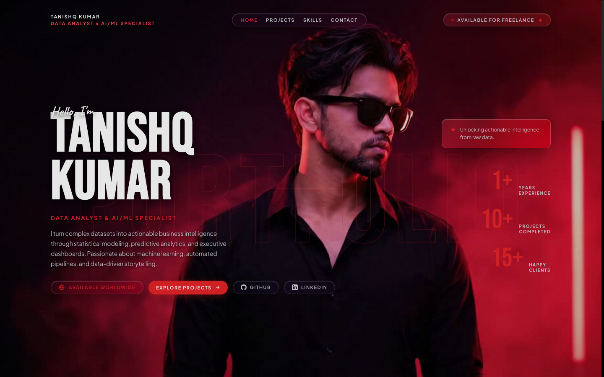
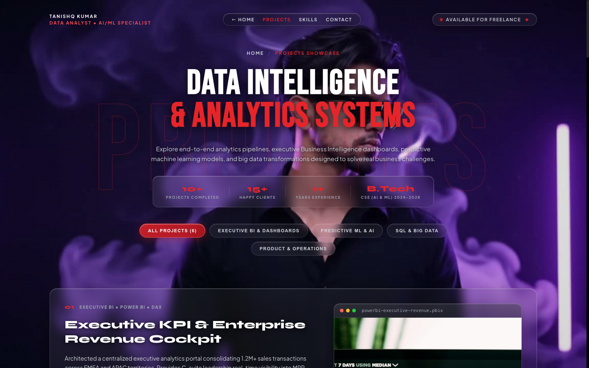

# Tanishq Kumar — Data Analyst Portfolio

[](https://vercel.com/new/clone?repository-url=https%3A%2F%2Fgithub.com%2Ftanishqkumar87919-dot%2Ftanishq-portfolio)
[](https://github.com/tanishqkumar87919-dot)
[](https://www.linkedin.com/in/tanishq-kumar-272a712b5/)

> A high-performance, immersive Data Analyst portfolio featuring a smooth 4K scroll-driven 3D canvas animation, interactive glassmorphic cards, and comprehensive data intelligence showcases.

---

## 📸 Portfolio Preview

### Hero & 3D Sequence View


### Complete Page Preview
<p align="center">
  
</p>

### Projects Showcase Page Preview
<p align="center">
  
</p>

---

## ✨ Key Features

- **4K Scroll-Driven 3D Animation**: 238 Ultra-HD (3840 × 2160) frames preloaded into memory and scrubbed smoothly via high-DPI HTML5 Canvas.
- **Double-Smoothed Inertia**: Integrates **Lenis** smooth scroll physics with a `requestAnimationFrame` linear interpolation (lerp) loop for seamless 60–120 FPS momentum.
- **Modern Glassmorphic UI**: Translucent cards with subtle dark backdrop-blur filters that let the 3D visual animation breathe beneath the content.
- **Real-World Analytics Showcase**:
  - `01` **Sales Intelligence Suite**: Executive KPI dashboard with Power BI, SQL, and DAX.
  - `02` **Customer Churn Predictor**: Machine Learning & Retention classification model.
  - `03` **Global Market Dynamics**: BigQuery NLP & advanced sentiment trend analytics.
- **Comprehensive Lifecycle**: Highlights the 5 core phases of the analytics workflow (Data Discovery, ETL Pipelines, Exploratory Analysis, Modeling & BI, Strategy).
- **Responsive & Accessible**: Optimized for all viewports from 4K desktop displays down to mobile devices.

---

## 🛠️ Tech Stack

- **Frontend & Canvas**: HTML5 Canvas, Modern CSS3 (Grid, Flexbox, Glassmorphism, CSS Variables)
- **Scripting & Animation**: Vanilla JavaScript (ES6+), [Lenis](https://github.com/darkroomengineering/lenis) smooth scroll
- **Tooling & Bundler**: [Vite](https://vitejs.dev/)
- **Image Enhancement**: Apple CoreImage Lanczos Resampling (`CILanczosScaleTransform`) & GPU Unsharp Masking

---

## 🚀 Getting Started

### Prerequisites
- Node.js (v18 or higher)
- npm or yarn

### Installation

1. **Clone the repository**:
   ```bash
   git clone https://github.com/tanishqkumar87919-dot/tanishq-portfolio.git
   cd tanishq-portfolio
   ```

2. **Install dependencies**:
   ```bash
   npm install
   ```

3. **Start local development server**:
   ```bash
   npm run dev
   ```
   Open [http://localhost:5173](http://localhost:5173) in your browser.

4. **Build for production**:
   ```bash
   npm run build
   ```

---

## ☁️ Deploy on Vercel

You can deploy this portfolio to Vercel with a single click:

[](https://vercel.com/new/clone?repository-url=https%3A%2F%2Fgithub.com%2Ftanishqkumar87919-dot%2Ftanishq-portfolio)

### Manual Vercel Deployment via CLI
```bash
npm i -g vercel
vercel
```

---

## 📬 Contact & Connect

- **Email**: [tanishqkumar87919@gmail.com](mailto:tanishqkumar87919@gmail.com)
- **Phone**: [+91 87919 79484](tel:8791979484)
- **GitHub**: [github.com/tanishqkumar87919-dot](https://github.com/tanishqkumar87919-dot)
- **LinkedIn**: [linkedin.com/in/tanishq-kumar](https://www.linkedin.com/in/tanishq-kumar-272a712b5/)
- **Location**: India
